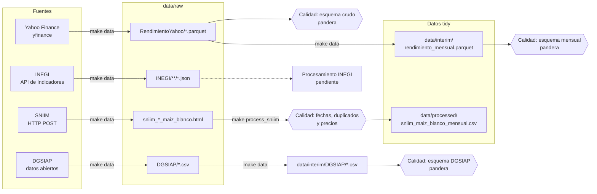

<a target="_blank" href="https://cookiecutter-data-science.drivendata.org/">
    
</a>


# Rendimiento bursátil de Gruma
Proyecto dedicado al proyecto de la materia de Ingenieria de Caracteristicas en la maestria de Ciencia de Datos.

> Estado: propuesta preliminar sujeta a validación de disponibilidad y calidad de los datos.

## Problemática
El *maíz* constituye uno de los principales insumos utilizados en la elaboración de harina de maíz y también de las *tortillas*. Tener variaciones de sus precios pueden representar cambios en los costos y en las condiciones del mercado en el que participa la empresa **Gruma**.

Los precios del maíz representan variacioens temporales y regionales entre los diferentes mercados mayoristas del país. En este proyecto, se busca integrar estos datos con el compartamiento histórico de las acciones de Gruma. 

## Pregunta de investigación
¿Qué relación tuvieron las variaciones de los precios regionales del maíz en México con los rendimientos mensuales de las acciones de Gruma en la Bolsa Mexicana de Valores entre 2013 y 2025?

Esta investigación tiene un alcance descriptivo y exploratorio, por lo cual los hallazgos no se interpretaran como causales.

## Público destinatario

El producto de datos final (tablero e historias de datos) está pensado para:

- **Analistas e inversionistas del sector agroalimentario**, que quieren saber si el costo del maíz es una señal útil para el comportamiento de una empresa como Gruma en la bolsa.
- **Periodistas y público general interesado en el precio de la tortilla**, que siguen cómo el precio del maíz se traslada a lo largo de la cadena, del campo al consumidor.
- **Estudiantes e investigadores** que buscan un ejemplo reproducible de integración de series de tiempo, datos geográficos y datos de mercado.

## Fuentes de datos preliminares

### Bolsa Mexicana de Valores y Yahoo Finance

Se utilizarán para consultar y validar los precios históricos de las acciones Serie B de Gruma. La clave de cotización es `GRUMA B` en la Bolsa Mexicana de Valores y `GRUMAB.MX` en Yahoo Finance.

- Bolsa Mexicana de Valores: https://www.bmv.com.mx/es/emisoras/perfil/-5454
- Yahoo Finance: https://finance.yahoo.com/quote/GRUMAB.MX/

### Sistema Nacional de Información e Integración de Mercados

El SNIIM, perteneciente a la Secretaría de Economía, publica precios del maíz en mercados mayoristas de distintas ciudades y estados de México.

- https://www.economia-sniim.gob.mx/analisis/Precios.asp

Esta fuente contiene información temporal, cuantitativa, cualitativa y geográfica, como fecha, mercado, ciudad, estado, variedad, presentación y precio.

### Fuentes complementarias: DGSIAP

Como posible fuente complementaria se evaluarán los datos abiertos de producción de maíz por estado y municipio.

- https://nube.agricultura.gob.mx/datosAbiertos/Agricola.php

### Fuentes complementarias: INEGI

Adicionalmente se analizan una variedad de indicadores de la base de datos abierta del Instituto Nacional de Estadística y Geografía (INEGI)

- https://www.inegi.org.mx/servicios/api_indicadores.html

### Fuentes complementarias: CONASAMI, PROFECO y ENIGH

- **CONASAMI:** salario mínimo general por mes y zona (2013–2025). Salida: `data/processed/salario_minimo_mensual.csv`; diccionario en `references/diccionario_salario_minimo.md`.
- **PROFECO (Quién es quién en los precios):** precio mensual de la tortilla de maíz por estado y giro (2015–2026). Salida: `data/processed/precio_tortilla_mensual.csv`; diccionario en `references/diccionario_precio_tortilla.md`.
- **ENIGH (INEGI):** consumo y gasto en tortilla por hogar (2014–2024, bienal). Salida: `data/processed/enigh_tortilla_hogar.csv`; diccionario en `references/diccionario_enigh_tortilla.md`.
- **INPC (INEGI):** índice nacional de precios al consumidor mensual, serie general (2013 a la fecha; requiere `INEGI_API_KEY`). Salida: `data/processed/inpc_mensual.csv`; diccionario en `references/diccionario_inpc.md`. Se descarga con `make data_inpc`.

## Tipos de datos

- **Series de tiempo:** precios de la acción y precios del maíz.
- **Datos geográficos:** mercados, ciudades, estados y municipios.
- **Datos cuantitativos:** precios, volúmenes y rendimientos bursátiles.
- **Datos cualitativos:** producto, variedad, presentación y mercado.

## Ingesta de datos

Hasta ahora el proyecto cubre la ingesta automatizada de las fuentes, su
transformación a formato *tidy* y la validación de calidad de los datos. Todo se
orquesta desde `rendimiento_bachoco/dataset.py`; cada fuente tiene su propio módulo
en `rendimiento_bachoco/sources/` y las reglas de calidad viven en
`rendimiento_bachoco/quality/`.

### Fuentes y APIs

| Fuente | Acceso | Qué se descarga | Salida cruda (`data/raw/`) |
|---|---|---|---|
| **Yahoo Finance** | Librería [`yfinance`](https://github.com/ranaroussi/yfinance) | Histórico diario completo (`period="max"`) de `GRUMAB.MX` y `MINSAB.MX`, ajustado por dividendos y splits | `RendimientoYahoo/<TICKER>.parquet` + `.txt` de metadatos |
| **SNIIM** | `POST` a `economia-sniim.gob.mx/SNIIM-AN/estadisticas/anuariosgran1.asp` | Anuario de precios mensuales de maíz blanco (`OMABLAN`) en cinco mercados: Hermosillo (`260`), Culiacán (`250`), Guadalajara (`140`), Iztapalapa (`100`) y Guadalupe (`191`) | `sniim_<mercado>_maiz_blanco.html` + `.txt` de metadatos |
| **INEGI** | [API de Indicadores](https://www.inegi.org.mx/servicios/api_indicadores.html) (BISE 2.0), requiere token | 19 indicadores del BISE; dos de ellos (`6207095692`, `6207095719`) se consultan por entidad federativa y el resto a nivel nacional | `INEGI/<indicador>/<área>.json` y `INEGI/METADATA/<indicador>.json` |
| **DGSIAP** | Datos abiertos de `nube.agricultura.gob.mx` | Producción agrícola por estado y municipio, un archivo por año (2018–2025 en los datos descargados; `DGSIAP_START_YEAR` en `config.py` está en 2013), más el diccionario de datos | `DGSIAP/<año>.csv`, `DGSIAP/metadata.xlsx` |

Cada descarga deja junto a los datos un archivo de metadatos o de log con la fecha
de consulta, la URL y los parámetros usados, para poder rastrear el origen.

Los tickers se configuran en `TICKERS_YAHOO` (`rendimiento_bachoco/config.py`); los
mercados del SNIIM, los indicadores del INEGI y el rango de años de DGSIAP, en
`rendimiento_bachoco/dataset.py`.

### Cómo generar los datos

1. Instala las dependencias (Python 3.12 y [uv](https://docs.astral.sh/uv/)); `uv`
   crea el entorno virtual `.venv` si no existe:

   ```bash
   make requirements
   ```

2. Crea un archivo `.env` en la raíz del repositorio con tu token de la API del INEGI:

   ```bash
   INEGI_API_KEY=tu_token
   ```

3. Descarga, procesa y valida todas las fuentes:

   ```bash
   make data
   ```

   Equivale a `uv sync` seguido de `uv run python rendimiento_bachoco/dataset.py`,
   así que no hace falta activar el entorno virtual.

4. Transforma los precios del SNIIM a formato *tidy* (necesita los cinco HTML que
   deja el paso anterior):

   ```bash
   make process_sniim
   ```

   Sin `make`: `uv run python rendimiento_bachoco/process_sniim.py`.

5. Opcional: corre una sola de las fuentes nuevas (descarga, procesa y valida;
   `make data` ya las incluye):

   ```bash
   make data_conasami
   make data_profeco   # reprocesa los RAR, ~7 min
   make data_enigh
   ```

   Equivalen a `uv run python rendimiento_bachoco/dataset.py --only <fuente>`.

Todos los comandos se ejecutan desde la raíz del repositorio. La carpeta `data/` no se
versiona, así que hay que generarla en cada copia del proyecto.

`make data` corre tres etapas en orden: descargas, procesamiento y validación. Si un
paso falla (por ejemplo, el INEGI cuando falta el token), se registra el error y los
demás pasos continúan; al final el comando lista los pasos fallidos y termina con
código de salida 1.

### Diagrama de la pipeline



### Datos generados

| Archivo | Granularidad | Contenido |
|---|---|---|
| `data/interim/rendimiento_mensual.parquet` | Una fila por mes, una columna por ticker | Rendimiento mensual `(cierre_t / cierre_{t-1}) - 1`, calculado con el último cierre de cada mes. Los meses sin operaciones quedan como `NaN`. |
| `data/processed/sniim_maiz_blanco_mensual.csv` | Una fila por mes, mercado y origen del maíz (2013–2025) | Precio del maíz blanco en MXN/kg. Las celdas vacías se conservan como dato faltante, no como cero. Ver `references/diccionario_sniim_maiz_blanco.md`. |

DGSIAP se filtra a los cultivos relacionados con Gruma (maíz, trigo, arroz y avena)
y se guarda por año en `data/interim/DGSIAP/`; ver `references/diccionario_dgsiap.md`.
El diccionario del rendimiento mensual está en
`references/diccionario_rendimiento_mensual.md`. La transformación de INEGI a
formato *tidy* está pendiente.

### Validación de la calidad de datos

**Yahoo Finance** se valida con esquemas de [pandera](https://pandera.readthedocs.io/)
(`rendimiento_bachoco/quality/yahoo.py`) como última etapa de `make data`:

| Conjunto | Reglas |
|---|---|
| Crudo diario (un parquet por ticker) | `Open`, `High`, `Low` y `Close` numéricos y mayores que 0; `Volume` entero no negativo; `Dividends` y `Stock Splits` no negativos. Índice de fechas, sin duplicados y en orden creciente. Coherencia entre precios: `High >= Low`, `High >= Open` y `Low <= Open`. |
| Rendimiento mensual | Exactamente una columna por ticker configurado, sin columnas extra. Rendimientos mayores que -1 (se permiten faltantes). Índice de fechas, sin duplicados y en orden creciente. Ninguna columna completamente vacía. |

Que `Close` quede dentro de `[Low, High]` se reporta como advertencia y no como
error, porque en días ex-dividendo yfinance ajusta el cierre con un factor distinto
al de los demás precios.

**SNIIM** se valida en dos momentos:

- Al descargar (`sources/sniim.py`): la respuesta debe contener el nombre del mercado
  y el año 2013; de lo contrario se descarta por no ser la tabla esperada.
- Al procesar (`process_sniim.py`): todas las fechas deben ser válidas y estar entre
  2013 y 2025, la combinación de fecha, mercado y origen no puede repetirse, y los
  precios presentes deben ser mayores que 0. Si alguna regla falla, no se escribe
  el CSV.

**DGSIAP** se valida con un esquema de pandera (`rendimiento_bachoco/quality/dgsiap.py`)
construido a partir de los metadatos oficiales: tipos de cada campo, tolerancia a los
nombres de columna que cambian entre años (`Nomcultivo`, `Precio`) e índice único.
`Rendimiento` y `Precio` admiten faltantes, que aparecen en 2024 y 2025.

**INEGI** tiene su propia validación en `rendimiento_bachoco/quality/inegi.py`; de cada
descarga se registra además un log.

## Project Organization

```
├── LICENSE            <- Open-source license if one is chosen
├── Makefile           <- Makefile with convenience commands like `make data` or `make train`
├── README.md          <- The top-level README for developers using this project.
├── data
│   ├── external       <- Data from third party sources.
│   ├── interim        <- Intermediate data that has been transformed.
│   ├── processed      <- The final, canonical data sets for modeling.
│   └── raw            <- The original, immutable data dump.
│
├── docs               <- A default mkdocs project; see www.mkdocs.org for details
│
├── models             <- Trained and serialized models, model predictions, or model summaries
│
├── notebooks          <- Jupyter notebooks. Naming convention is a number (for ordering),
│                         the creator's initials, and a short `-` delimited description, e.g.
│                         `1.0-jqp-initial-data-exploration`.
│
├── pyproject.toml     <- Project configuration file with package metadata for 
│                         rendimiento_bachoco and configuration for tools like black
│
├── references         <- Data dictionaries, manuals, and all other explanatory materials.
│
├── reports            <- Generated analysis as HTML, PDF, LaTeX, etc.
│   └── figures        <- Generated graphics and figures to be used in reporting
│
├── requirements.txt   <- The requirements file for reproducing the analysis environment, e.g.
│                         generated with `pip freeze > requirements.txt`
│
├── setup.cfg          <- Configuration file for flake8
│
└── rendimiento_bachoco   <- Source code for use in this project.
    │
    ├── __init__.py             <- Makes rendimiento_bachoco a Python module
    │
    ├── config.py               <- Store useful variables and configuration
    │
    ├── dataset.py              <- Orchestrates download, processing and validation (`make data`)
    │
    ├── process_sniim.py        <- Turns the raw SNIIM HTML into a tidy monthly CSV
    │
    ├── sources                 <- One download module per data source
    │   ├── dgsiap.py
    │   ├── inegi.py
    │   ├── sniim.py
    │   └── yahoo.py
    │
    ├── quality                 <- Data quality rules
    │   └── yahoo.py            <- pandera schemas for the Yahoo Finance data
    │
    ├── features.py             <- Code to create features for modeling
    │
    ├── modeling                
    │   ├── __init__.py 
    │   ├── predict.py          <- Code to run model inference with trained models          
    │   └── train.py            <- Code to train models
    │
    └── plots.py                <- Code to create visualizations
```

--------

