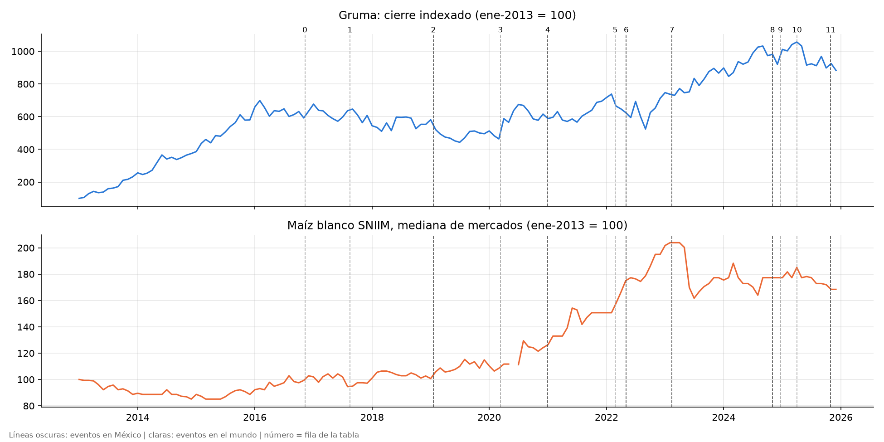
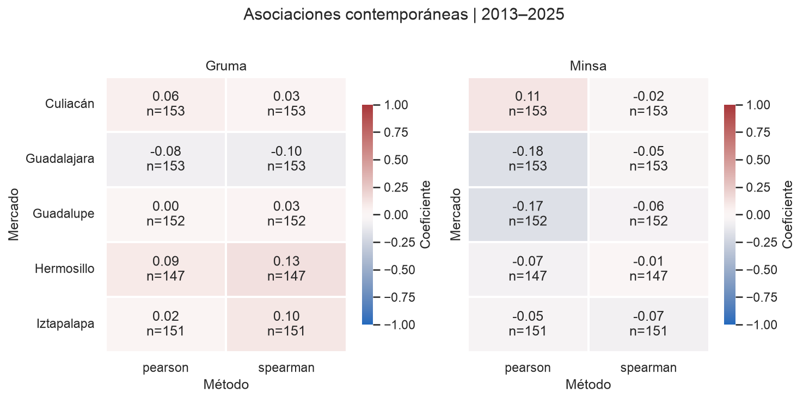
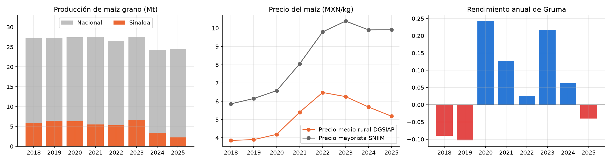

**Equipo:** IngCarac2026Unison · Maestría en Ciencia de Datos, Universidad de Sonora (Ingeniería de Características)

| Integrante | Correo | GitHub |
|---|---|---|
| Manuel Eduardo Gortarez Blanco | manuel_gortarez64@outlook.com | [Mgb64](https://github.com/Mgb64) |
| Marco Antonio Ramonet Moreno | es.ramonet@gmail.com | [marcoramonet](https://github.com/marcoramonet) |
| Oscar Gamaliel Sandoval Robles | oscarsandovalrobles05@gmail.com | [gamasand](https://github.com/gamasand) |

## Resumen

Exploramos si las variaciones del precio regional del maíz blanco en México se relacionan con el
rendimiento mensual de la acción de Gruma (`GRUMAB.MX`) entre 2013 y 2025. Cruzamos tres fuentes:
precios de cinco centrales de abasto del SNIIM, producción agrícola anual del DGSIAP y precios
bursátiles de Yahoo Finance. **El hallazgo principal es que, mes a mes, no hay relación:** en los
cinco mercados la correlación entre el cambio del precio del maíz y el rendimiento de Gruma está
entre −0.10 y 0.14, y ninguna es significativa, ni en el mismo mes ni con uno a tres meses de rezago.

El maíz sí tuvo un choque grande: su precio mayorista pasó de 6.7 MXN/kg (promedio de 2020) a 11.9 en
enero de 2023 (+78 %), impulsado por la pandemia y la invasión a Ucrania. Ese es el único evento en el que el
maíz y Gruma se movieron fuerte a la vez (maíz +16 %, Gruma −15 % en tres meses). Fuera de ese
episodio, las caídas y subidas fuertes de Gruma coinciden con eventos de comercio y tipo de cambio
(TLCAN, COVID, aranceles de EU), algo coherente con que cerca del 55 % de sus ventas son en Estados
Unidos. También encontramos que la caída de la producción en Sinaloa por la sequía de 2024–2025 (de
6.7 a 2.3 millones de toneladas) no encareció el maíz: el precio siguió bajando.

{width=92%}

## Hallazgos en detalle

### 1. Calidad y alcance de los datos

- **Bolsa.** Gruma no tuvo operación real de 2000 a 2007 (casi 100 % de días con volumen cero);
  de 2013 a 2025 opera prácticamente todos los días. Minsa (`MINSAB.MX`) tiene 86 de 156 meses sin
  cambio en su precio, así que la dejamos solo como comparación secundaria. Los rendimientos diarios
  de Gruma tienen colas pesadas (no son normales) y sus días atípicos se concentran en la crisis de
  2008–2009; en la ventana del proyecto el único mes atípico es abril de 2020 (+26.7 %).
- **SNIIM.** 960 registros mes–mercado–origen con 17.6 % de precios faltantes. Solo 12 combinaciones
  mercado–mes no tienen ningún precio; destacan Hermosillo (sep-2018 a ene-2019) y junio de 2020, sin
  precio en los cinco mercados. Conservamos los faltantes sin imputar.
- **DGSIAP.** Producción de *maíz grano* (no distingue maíz blanco) por municipio. Los archivos
  cambian nombres de columnas entre años (`Precio` / `Preciomediorural`) y los precios en cero
  corresponden a cosechas siniestradas, no a ventas a precio cero.

### 2. El precio del maíz no explica el rendimiento mensual de Gruma

{width=66%}

En Gruma, Pearson va de −0.08 a 0.09 y Spearman de −0.10 a 0.14. El resultado se mantiene al quitar
valores extremos (máximo 0.19 en Hermosillo), al usar un solo origen por mercado, al separar en tres
periodos (2013–2019, 2020–2022, 2023–2025) y al probar rezagos de uno a tres meses (todos con
p > 0.1). Además, los cinco mercados del SNIIM se mueven poco entre sí (la mayor correlación es
Guadalajara–Guadalupe, 0.30): el precio del maíz es muy local y sus saltos más grandes, como
Guadalupe en mayo de 2022 (+50 %) o Iztapalapa en julio de 2023 (−29 %), no coinciden con
movimientos de Gruma.

### 3. Los eventos se ven en el maíz, no tanto en Gruma

Revisamos 12 eventos y medimos el cambio de cada serie en los tres meses siguientes, comparándolo con
los percentiles 10 y 90 de cualquier ventana de tres meses.

| Evento | Gruma | Maíz |
|---|---|---|
| Inicia renegociación del TLCAN (ago-2017) | −11.5 % (fuerte) | +3.1 % |
| Se crea Segalmex y los precios de garantía (ene-2019) | −18.2 % (fuerte) | +4.9 % |
| Pandemia de COVID-19 (mar-2020) | +37.4 % (fuerte) | sin dato |
| **Invasión rusa a Ucrania (feb-2022)** | **−15.4 % (fuerte)** | **+16.2 % (fuerte)** |
| Decretos contra maíz transgénico (2020, 2023) | normal | normal |
| Sequía en Sinaloa (nov-2024) | +2.1 % | +2.5 % |
| Panel del T-MEC sobre maíz transgénico (dic-2024) | +13.1 % | 0.0 % |
| Aranceles generales de EU (abr-2025) | −12.6 % (fuerte) | −4.2 % |

Solo Ucrania mueve las dos series a la vez y en la dirección esperada (sube el insumo, baja la
acción). Los eventos regulatorios no dejan huella en ninguna.

### 4. Producción, precio rural y precio mayorista

- El precio medio rural del DGSIAP y el precio mayorista del SNIIM se mueven juntos (Spearman anual
  0.76): las dos fuentes cuentan la misma historia. El precio rural subió de 3,860 MXN/t en 2018 a
  6,481 en 2022 y bajó a 5,183 en 2025.
- La producción nacional se mantuvo en ~27 Mt hasta 2023 y cayó a ~24 Mt en 2024–2025, casi toda por
  Sinaloa. Aun así el precio bajó: el faltante se cubrió con importaciones, en un contexto de maíz
  internacional barato.
- A nivel anual los años con maíz caro (2020–2023) fueron buenos para Gruma (Spearman ≈ 0.4), lo
  contrario de lo que esperaríamos si el maíz fuera solo un costo. Con 8 años no es concluyente.

### Conclusión y siguientes pasos

Con estos datos, el precio regional del maíz no es una buena señal del rendimiento mensual de Gruma.
La empresa parece responder más al mercado general, al comercio con EU y al tipo de cambio. Para la
etapa de modelado proponemos agregar el tipo de cambio y los indicadores del INEGI, un precio
internacional del maíz (futuros de Chicago) y variables de ciclo agrícola (otoño-invierno y
primavera-verano), como sugirió el Dr. Adán Dionicio Flores Corral (CIPES) en la consulta del 27 de
octubre de 2026. El alcance es descriptivo: ninguna asociación aquí debe leerse como causal.

### Bibliografía

1. Secretaría de Economía. *SNIIM, precios de granos en mercados nacionales.* https://www.economia-sniim.gob.mx/
2. SADER–SIAP. *Datos abiertos de producción agrícola (DGSIAP).* https://nube.agricultura.gob.mx/datosAbiertos/Agricola.php
3. Yahoo Finance. *GRUMAB.MX, precios históricos* (vía `yfinance`). https://finance.yahoo.com/quote/GRUMAB.MX/
4. Expansión (17-abr-2024). *Gruma vive el boom de la tortilla fuera de México.* https://expansion.mx/empresas/2024/04/17/gruma-vive-el-boom-de-la-tortilla-fuera-de-mexico
5. Infobae (21-dic-2024). *México pierde disputa comercial contra EE.UU. y Canadá sobre maíz transgénico.* https://www.infobae.com/america/agencias/2024/12/21/mexico-pierde-disputa-comercial-contra-eeuu-y-canada-sobre-maiz-transgenico/
6. Luz Noticias (06-mar-2025). *Por sequía, Sinaloa tendrá la peor producción de maíz en su historia.* https://www.luznoticias.mx/2025-03-06/agro/por-sequia-sinaloa-tendra-la-peor-produccion-de-maiz-en-su-historia/236920
7. El Imparcial (07-nov-2025). *Gobierno y productores del Bajío acuerdan precio del maíz blanco tras protestas.* https://www.elimparcial.com/mexico/2025/11/07/gobierno-y-productores-del-bajio-acuerdan-precio-del-maiz-blanco-tras-protestas/
8. Libretas del proyecto en `notebooks/`: `01-mg-datos_bursatiles`, `00-autoeda-sniim`, `01-eda-sniim`, `01-eda-dgsiap`, `02-eda-sniim-bolsa`, `02-mg-cruce-eventos-maiz-sniim-dgsiap`.
